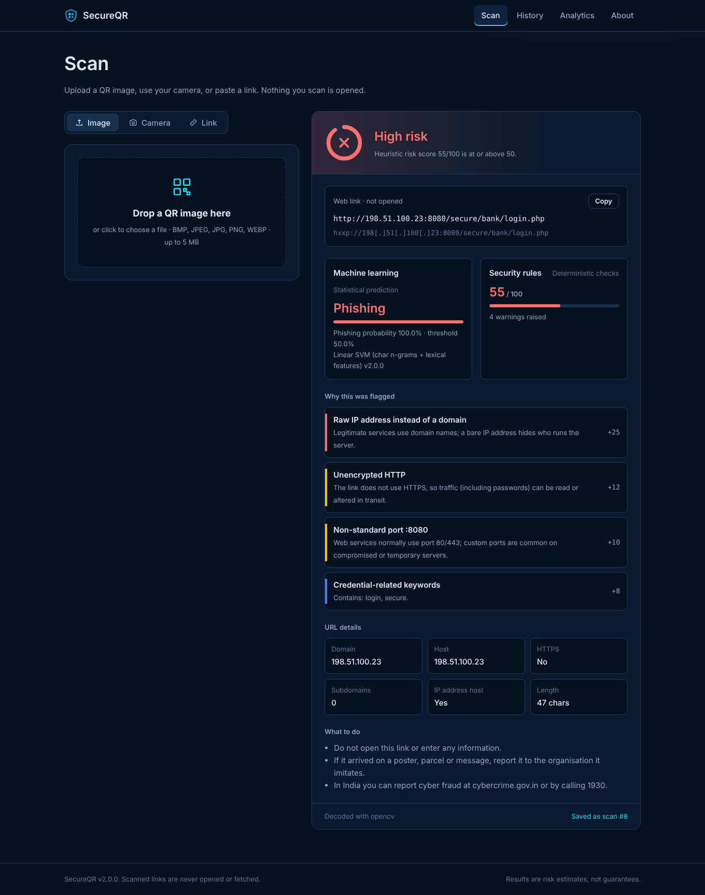
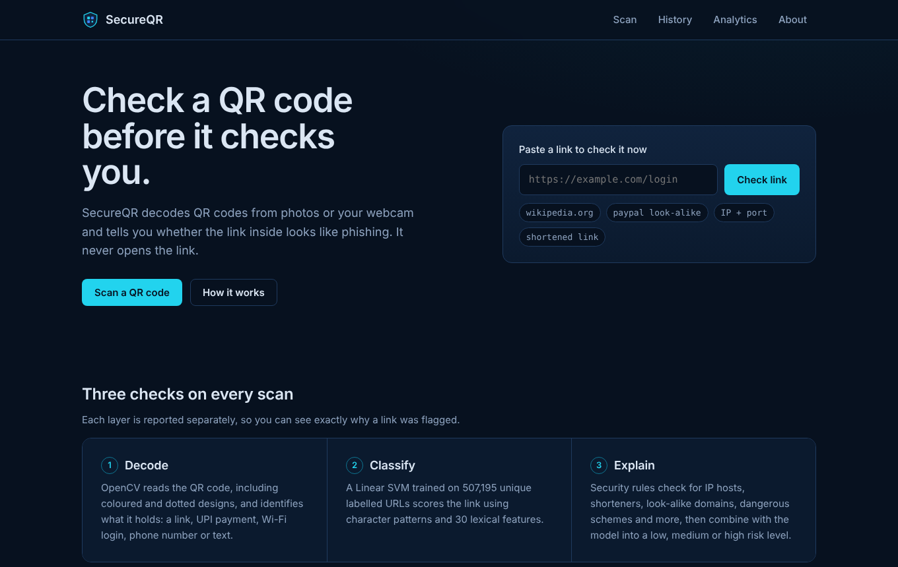
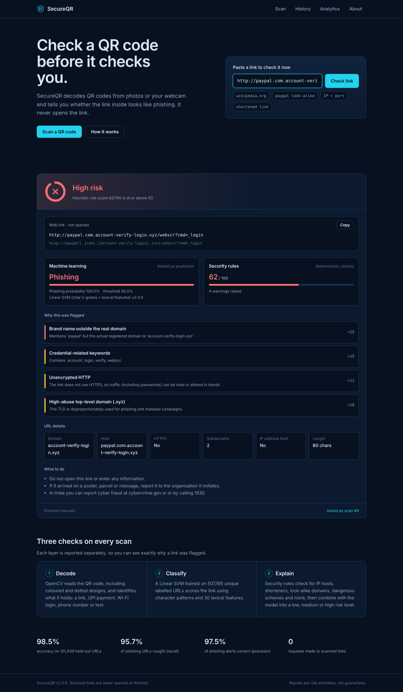
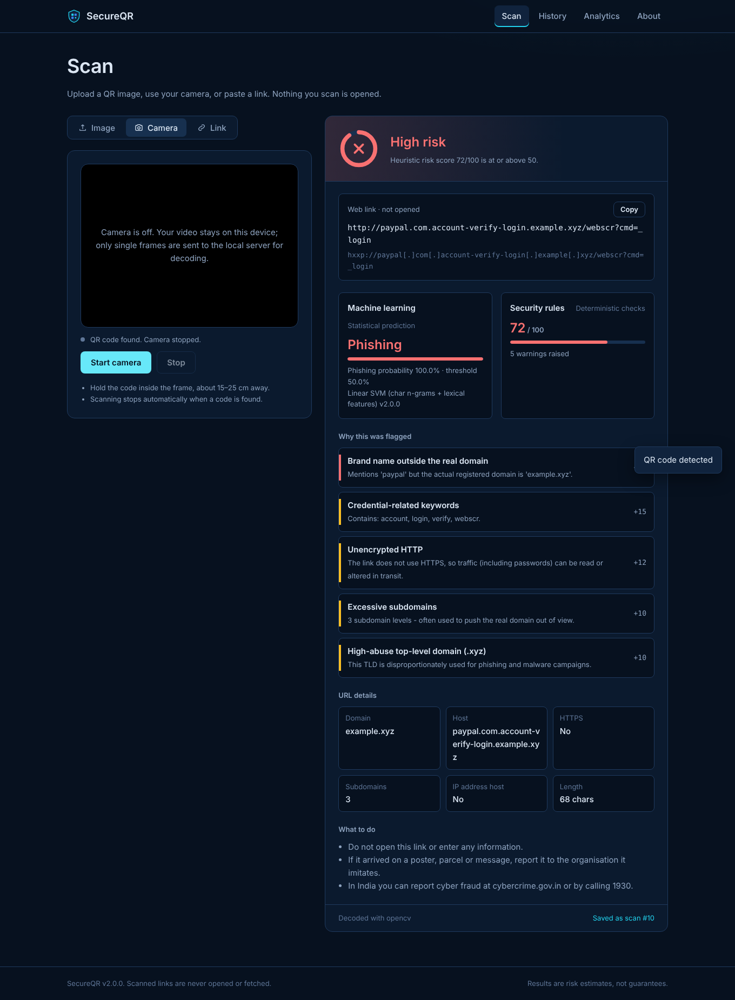
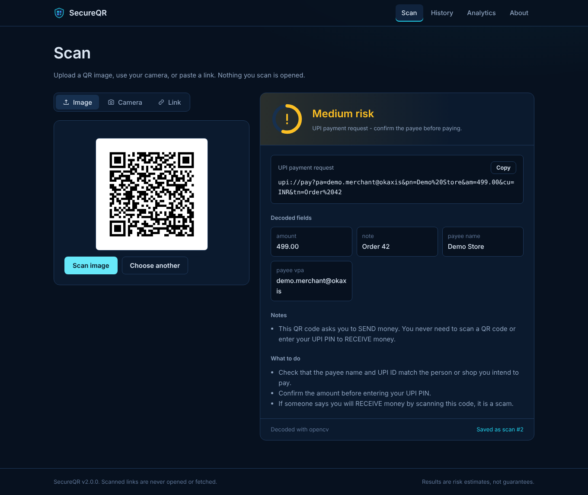
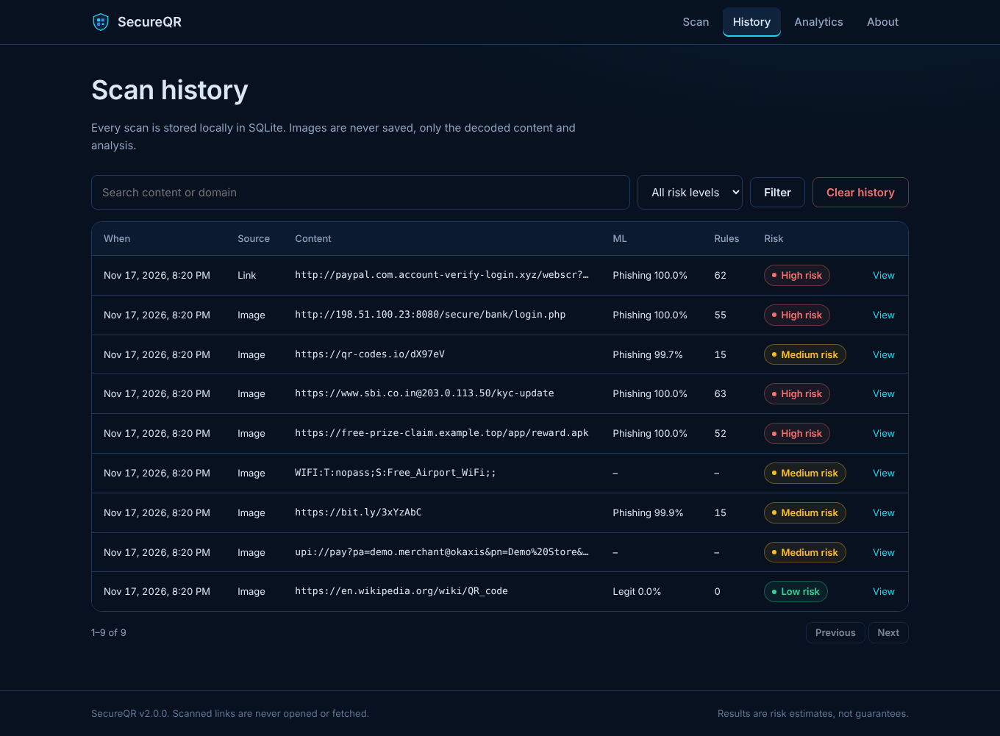
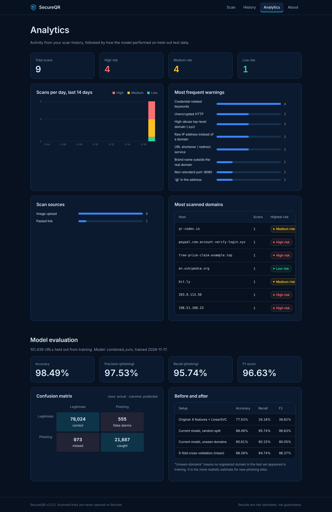

# SecureQR – Intelligent QR Code Security Scanner

SecureQR decodes QR codes from images or a live webcam and tells you whether the content is dangerous **before** you open it. It combines a Linear SVM phishing-URL classifier with an explainable rule engine, stores scan history in SQLite, and runs as a hardened Flask web app.

> Scanned links are **never opened, fetched or resolved**. Analysis is done on the text of the URL only.



## Highlights

| | |
|---|---|
| **Phishing model** | Linear SVM on character 3–5-gram TF-IDF + 30 lexical URL features, sigmoid-calibrated. **98.49% accuracy · 97.53% precision · 95.74% recall · F1 96.63%** on 101,439 held-out URLs; **90.05% F1 on domains never seen in training**. |
| **vs. original model** | The original 6-feature SVM reached 77.53% accuracy but caught only **26.18%** of phishing URLs (F1 39.82%). Root causes were found and fixed (see [Model evaluation](docs/MODEL_EVALUATION.md)). |
| **Explainable rules** | 20+ checks: IP or obfuscated-IP hosts, URL shorteners, `user@host` tricks, punycode, brand names outside the real domain, high-abuse TLDs, dangerous schemes (`javascript:`, `data:`), executable downloads, embedded redirects, non-standard ports, missing HTTPS… |
| **Beyond URLs** | Recognises UPI payment requests, Wi-Fi credentials, SMS, phone, e-mail and contact QR codes, with type-specific warnings. |
| **Robust decoding** | OpenCV multi-pass decoder recovers coloured and dotted "designer" QR codes that a plain detector misses. pyzbar is used too when installed. |
| **Security** | CSRF tokens, per-IP rate limiting, strict CSP (no inline JS/CSS), parameterised SQL, in-memory upload validation (size, type, magic bytes, pixel bomb), secure cookies, no outbound requests (no SSRF). |
| **Tested** | 155 pytest tests covering decoding, URL extraction, features, ML, rules, API, database and security controls, plus an end-to-end webcam test in headless Chrome. |

## Contents
- [Quick start (Windows)](#quick-start-windows)
- [Features](#features)
- [How it works](#how-it-works)
- [Model results](#model-results)
- [Project structure](#project-structure)
- [Testing](#testing)
- [Configuration](#configuration)
- [API](#api)
- [Screenshots](#screenshots)
- [Limitations & future work](#limitations--future-work)

## Quick start (Windows)

Requires **Python 3.11–3.14** (3.12 or 3.13 recommended). See [RUNNING_GUIDE.md](RUNNING_GUIDE.md) for every step, the VS Code workflow and troubleshooting.

**One-command setup** (creates `venv`, installs packages, writes `.env` with a random secret key, then runs a health check):

```powershell
cd $HOME\SecureQR
powershell -ExecutionPolicy Bypass -File .\setup.ps1
powershell -ExecutionPolicy Bypass -File .\run.ps1      # open http://127.0.0.1:5000
powershell -ExecutionPolicy Bypass -File .\test.ps1     # 155 tests
```

**Manual setup:**

```powershell
python -m venv venv
.\venv\Scripts\Activate.ps1
pip install -r requirements.txt
copy .env.example .env          # then set SECUREQR_SECRET_KEY
python scripts\check_setup.py   # pre-demo health check
python run.py                   # open http://127.0.0.1:5000
```

**VS Code:** open the folder, choose the `venv` interpreter, then press **F5** and pick *SecureQR: run web app*. Tests appear in the Testing panel.

The trained model (`model/secureqr_model.joblib`, 4.9 MB) is included. To retrain: `python -m secureqr.ml.train` (about 20 minutes).

macOS/Linux: use `source venv/bin/activate` and `cp` instead of `copy`.

## Features

- **Landing page** with an instant link check.
- **Scanner** with three inputs: image upload (drag-and-drop or paste), **live webcam** (one frame every 0.7 s, stops automatically when a code is found) and a pasted link.
- **Threat analysis**: overall LOW / MEDIUM / HIGH risk with reasons; ML prediction and rule findings shown **side by side**; defanged URL (`hxxps://example[.]com`) for safe sharing; recommended next steps.
- **History**: searchable, filterable and paginated; per-scan detail page; delete one scan or clear all.
- **Analytics**: scans per day by risk, most frequent warnings, sources, most scanned domains, plus model metrics, confusion matrix and before/after comparison.
- **About** page that explains the method and its limits.
- **Optional desktop tools** (`desktop_app/`): a Tkinter GUI and an OpenCV webcam window built on the same core.
- **11 safe demo QR codes** in `demo_qr/`, made with reserved documentation domains and IPs.

## How it works

```
upload / webcam frame / link
        │
        ▼
validate (size, extension, magic bytes, Pillow verify, pixel limit) ── in memory, never saved
        │
        ▼
decode QR (pyzbar → OpenCV → thresholded/eroded variants)
        │
        ▼
classify payload: URL · UPI · Wi-Fi · SMS · phone · e-mail · vCard · text · javascript:/data:
        │ URL
        ├──────────────► ML: canonicalise → [char n-gram TF-IDF ‖ 30 lexical] → calibrated LinearSVC → P(phishing)
        └──────────────► Rules: 20+ explainable checks → score 0-100 + findings
                                   │
                                   ▼
                     risk policy → LOW / MEDIUM / HIGH + reasons → SQLite → UI
```

**Risk policy:** HIGH if a critical rule fires, the rule score is ≥ 50, or the model is ≥ 80% sure *and* a medium-or-higher rule agrees. MEDIUM if the model says phishing, the rule score is ≥ 20, or any high-severity rule fires. Otherwise LOW. **ML alone never produces HIGH**, which limits the impact of model false positives.

Full details: [docs/ARCHITECTURE.md](docs/ARCHITECTURE.md).

## Model results

Dataset: Kaggle `phishing_site_urls.csv`, 549,346 rows, **507,195 after removing duplicates** (22.5% phishing). Stratified 80/20 split.

| Model | Accuracy | Precision | Recall | F1 |
|---|---|---|---|---|
| Original: 6 features + LinearSVC (reproduced) | 77.53% | 83.18% | 26.18% | 39.82% |
| Lexical features (30) + LinearSVC | 88.01% | 84.52% | 57.28% | 68.28% |
| Lexical features + Gradient Boosting | 93.96% | 91.21% | 81.00% | 85.80% |
| Char n-grams + LinearSVC | 98.18% | 97.90% | 93.95% | 95.88% |
| **Char n-grams + lexical + LinearSVC (final, test set)** | **98.49%** | **97.53%** | **95.74%** | **96.63%** |
| Final model, unseen domains | 95.61% | 89.96% | 90.15% | 90.05% |

Rows 2–4 are validation-split results used for model selection. 5-fold CV of the final pipeline: accuracy 98.39% ± 0.03%, F1 96.37% ± 0.07%. Test ROC-AUC 0.997. Confusion matrix: 555 false positives out of 78,579 legitimate URLs (0.71%), 973 missed out of 22,860 phishing URLs (4.26%).

Two fixes mattered most:
1. **Train/serve skew:** every URL in the dataset that has a scheme is labelled phishing, but real QR codes start with `https://`. The old `https` feature learned the wrong thing. Schemes are now stripped before the model sees the URL.
2. **Representation:** character n-grams capture patterns such as `paypal.com.`, `webscr`, `.php?cmd=` and random-looking strings that six counts cannot.

The full report, with the validation comparison, CV and spot-checks including a documented false positive, is in [docs/MODEL_EVALUATION.md](docs/MODEL_EVALUATION.md).

## Project structure

```
SecureQR/
├── run.py                      # start the web server
├── secureqr/                   # application package
│   ├── __init__.py             # Flask app factory, logging, error handlers
│   ├── config.py               # environment-based configuration
│   ├── security.py             # CSRF, rate limiter, security headers
│   ├── db.py                   # SQLite scan history
│   ├── views.py                # pages + JSON API
│   ├── core/
│   │   ├── qr_decoder.py       # upload validation + multi-pass QR decoding
│   │   ├── content.py          # payload classification, URL extraction, defanging
│   │   ├── heuristics.py       # explainable URL rule engine
│   │   ├── predictor.py        # model loading / inference
│   │   └── analyzer.py         # combines ML + rules into a risk level
│   ├── ml/
│   │   ├── features.py         # canonicalisation + 30 lexical features (shared)
│   │   ├── pipeline.py         # sklearn pipelines
│   │   └── train.py            # training + evaluation + report
│   ├── templates/              # Jinja2 pages
│   └── static/                 # CSS, JS, favicon
├── model/                      # trained model, metrics.json, confusion matrix, report
├── dataset/phishing_site_urls.csv
├── demo_qr/                    # safe demonstration QR codes
├── scripts/generate_demo_qr.py # regenerate demo_qr/
├── desktop_app/                # optional Tkinter + OpenCV clients
├── tests/                      # pytest suite
├── docs/                       # architecture, API, model evaluation, screenshots
├── scripts/check_setup.py      # pre-demo health check
├── setup.ps1 · run.ps1 · test.ps1   # Windows one-command scripts
├── .vscode/                    # run/debug configs, pytest integration
├── RUNNING_GUIDE.md · INTERVIEW_PREPARATION.md · RESUME_DESCRIPTION.md · DEMO_SCRIPT.md
├── requirements.txt · requirements-optional.txt · .env.example · pytest.ini · .gitignore · .gitattributes
```

## Testing

```powershell
python -m pytest            # 155 tests, about 10 s
python -m pytest -v tests/test_api.py
```

The suite trains a small model on 8,000 dataset rows at session start, so it does not depend on the shipped model. One test also checks the shipped model if it exists.

| Area | File |
|---|---|
| QR decoding (PNG/JPG/BMP/WEBP, coloured, stylised, multiple codes, no code) and upload validation | `test_qr_decoder.py` |
| Payload classification, URL extraction, defanging | `test_content.py` |
| Canonicalisation, feature vector, malformed URLs, scheme invariance | `test_features.py` |
| Each heuristic rule, IP handling | `test_heuristics.py` |
| Model loading, predictions, train/inference consistency, graceful failure | `test_ml.py` |
| Risk policy | `test_analyzer.py` |
| Database, SQL-injection strings, stats | `test_db.py` |
| Endpoints, CSRF, headers, cookies, 413/422/429, stored XSS, error handling | `test_api.py` |
| All demo QR codes end to end | `test_demo_qr.py` |

## Configuration

All settings come from environment variables or a `.env` file (see [.env.example](.env.example)): secret key, database/model/log paths, upload limits, rate limits, proxy trust and secure cookies. Logs are written to `logs/secureqr.log` (rotating). History is stored in `instance/secureqr.db`. Both folders are git-ignored.

## API

JSON endpoints for scanning (`/api/scan/image`, `/api/scan/frame`, `/api/scan/url`), history, stats, model metrics and health. See [docs/API.md](docs/API.md).

## Screenshots

| | |
|---|---|
|  |  |
| Landing page | Phishing look-alike, explained |
|  |  |
| Webcam scan | UPI payment QR |
|  |  |
| Scan history | Analytics and model evaluation |

## Limitations & future work

- The model sees **only the URL text**: no page content, domain age, DNS or reputation data. A new phishing site on a clean-looking domain can score low.
- The training data is older and US-centric. Indian domains and modern short links are under-represented, and false positives happen (documented in the evaluation report).
- Shortened links are flagged but not expanded. Expanding them would need a sandboxed, SSRF-safe resolver.
- Rate limiting is in-memory and per process. Use Redis for multi-worker deployments.
- Future work: safe redirect expansion in an isolated worker, domain-age/WHOIS features, Public Suffix List, Google Safe Browsing / PhishTank lookups, a browser extension, Docker image, CI pipeline.

## Credits

Dataset: [Phishing Site URLs (Kaggle)](https://www.kaggle.com/datasets/taruntiwarihp/phishing-site-urls). Built with Flask, scikit-learn, OpenCV and Pillow.
