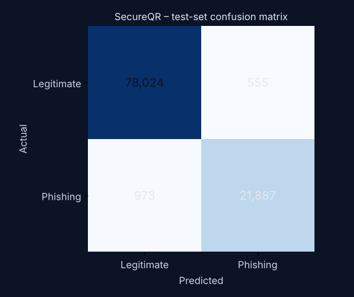

# Model evaluation

All numbers below come from one run of `python -m secureqr.ml.train` (random seed 42, scikit-learn 1.9.1, Python 3.13). They are written to `model/metrics.json`, and `model/evaluation_report.md` is generated from that file. Re-running the script reproduces them, give or take tiny floating-point differences.

## Dataset

Kaggle `phishing_site_urls.csv` (`dataset/`).

| | Rows | Legitimate ("good") | Phishing ("bad") |
|---|---|---|---|
| Raw | 549,346 | 392,924 | 156,422 |
| After removing duplicate URLs | **507,195** | 392,897 | 114,298 (22.5%) |

42,151 rows were exact duplicates (no URL had conflicting labels). The original project trained and tested **with** duplicates, so identical URLs could appear in both train and test. The new pipeline de-duplicates first, then makes a stratified 80/20 split: **405,756 train / 101,439 test**.

### A data issue that affected the old model

Only 107 of 507,195 URLs carry a scheme (`http://` or `https://`), and **all 107 are labelled phishing**. The old feature `https = url.startswith("https")` therefore learned "has a scheme ⇒ suspicious", while nearly every real QR code begins with `https://`. The new pipeline strips the scheme before feature extraction, in training and at inference. HTTPS is checked by the separate rule engine instead.

## 1 · Original model, reproduced

6 features (length, dots, hyphens, digits, `@`, `https`) + `LinearSVC`, same split as the original script:

| Accuracy | Precision | Recall | F1 |
|---|---|---|---|
| **77.53%** | 83.18% | **26.18%** | 39.82% |

Confusion matrix: TN 77,018 · FP 1,652 · FN **23,032** · TP 8,168.

This matches the ~77.5% in the original README. But a model that **always predicts "legitimate"** would score 71.6% on the same split, and the old model missed **74% of phishing URLs**. Accuracy alone hid that.

## 2 · Model comparison (validation split carved from the training set)

| Model | Features | Accuracy | Precision | Recall | F1 | Fit time |
|---|---|---|---|---|---|---|
| LinearSVC | 30 lexical | 0.8801 | 0.8452 | 0.5728 | 0.6828 | 14 s |
| HistGradientBoosting | 30 lexical | 0.9396 | 0.9121 | 0.8100 | 0.8580 | 19 s |
| LinearSVC | char 3–5-gram TF-IDF | 0.9818 | 0.9790 | 0.9395 | 0.9588 | 22 s |
| LinearSVC, C=0.5 | char n-grams + lexical | 0.9831 | 0.9817 | 0.9425 | 0.9617 | 68 s |
| **LinearSVC, C=1.0** | **char n-grams + lexical** | **0.9842** | **0.9817** | **0.9477** | **0.9644** | 81 s |
| Logistic Regression | char n-grams + lexical | 0.9819 | 0.9792 | 0.9399 | 0.9591 | 155 s |

Selection metric: F1 on the phishing class (the dataset is imbalanced, so accuracy is not used).

**Should Linear SVM stay?** Yes. The biggest gain came from the **feature representation**, not from changing the algorithm. With good features, a linear SVM beat logistic regression and a gradient-boosted tree model on hand-crafted features, trained about 2× faster than logistic regression, and stays small (4.9 MB) and fast (≈1 ms per URL). Hand-crafted features on their own top out at about 0.86 F1, even with a non-linear model.

## 3 · Five-fold stratified cross-validation (training split, uncalibrated)

| Metric | Mean | Std |
|---|---|---|
| Accuracy | 0.9839 | 0.0003 |
| Precision | 0.9805 | 0.0012 |
| Recall | 0.9474 | 0.0013 |
| F1 | 0.9637 | 0.0007 |

The very small standard deviation shows the result is stable across folds.

## 4 · Held-out test set (final calibrated model, threshold 0.5)

The final model wraps the LinearSVC in `CalibratedClassifierCV(method="sigmoid", cv=3)` so it outputs probabilities. It was trained on the full training split and evaluated **once** on the 101,439 test URLs.

| Accuracy | Precision | Recall | F1 | ROC-AUC |
|---|---|---|---|---|
| **98.49%** | **97.53%** | **95.74%** | **96.63%** | 0.9970 |

| | Predicted legitimate | Predicted phishing |
|---|---|---|
| **Actual legitimate** (78,579) | 78,024 | 555 (false-positive rate 0.71%) |
| **Actual phishing** (22,860) | 973 (missed, 4.26%) | 21,887 |



Compared with the original model: accuracy +20.96 points, recall 26.18% → 95.74%, F1 39.82% → 96.63%.

## 5 · Harder test: unseen domains

A random split lets URLs from the same site (e.g. many `wikipedia.org` pages) land in both train and test, which flatters the score. To estimate performance on **new** sites, I also grouped URLs by approximate registered domain (150,716 groups) and used `GroupShuffleSplit`, so no domain appears on both sides:

| Accuracy | Precision | Recall | F1 |
|---|---|---|---|
| 95.61% | 89.96% | 90.15% | 90.05% |

**This is the more honest number to quote for unknown links.** Precision drops the most: on brand-new domains, about 1 in 10 phishing alerts is a false alarm.

## 6 · Spot checks (real-world-style URLs)

| P(phishing) | URL | Comment |
|---|---|---|
| 0.000 | `https://www.google.com/` | ✓ |
| 0.000 | `https://en.wikipedia.org/wiki/QR_code` | ✓ |
| 0.004 | `https://www.nie.ac.in/` | ✓ |
| 0.151 | `https://www.amazon.in/` | ✓ but not confident (`.in` retail domains are rare in the data) |
| 0.304 | `https://www.sbi.co.in/` | ✓ but not confident (`sbi.co.in` never appears in the dataset) |
| **0.860** | `https://github.com/aish00625/SecureQR` | ✗ **false positive** |
| 1.000 | `http://paypal.com.account-verify-login.xyz/webscr?cmd=_login` | ✓ |
| 1.000 | `http://192.168.10.5/secure/bank/login.php` | ✓ |
| 0.983 | `http://free-gift-card-winner.top/claim-now.html` | ✓ |
| 0.999 | `https://bit.ly/3xYzAbC` | flagged, but the model cannot see where a short link leads |

The GitHub false positive is worth understanding. `github.com` itself is fine in the data (31 of 32 URLs are labelled legitimate). The score comes from the **path**: digit-heavy, random-looking tokens such as `aish00625` resemble the random strings in phishing URLs. This is why the app **never lets ML alone produce a HIGH risk level**. It needs a corroborating rule. In the app, this URL shows as MEDIUM with the explanation "ML model classifies the URL as phishing" and no rule warnings.

## Limitations

- **Dataset age and distribution.** The URLs are mostly 2010s-era and English/US-centric. Indian domains (`.co.in`, `.gov.in`), modern SaaS links and QR-generator short links are under-represented. Precision on today's QR codes will be lower than the test set suggests.
- **Lexical only.** The model sees only the URL string: no page content, WHOIS age, DNS, certificate or reputation feeds. This is by design (no network access, no SSRF), but it limits what the model can detect.
- **Shortened links.** The real destination is unknown without following the redirect, which the app deliberately does not do.
- **Calibration.** Probabilities are sigmoid-calibrated on the training distribution. Values like "100.0%" are rounded and should not be read literally on out-of-distribution URLs.
- **Approximate registered domains.** Domain grouping uses a heuristic, not the Public Suffix List.

## Reproducing

```powershell
python -m secureqr.ml.train            # full run, ~20 min on a 2-core machine
python -m secureqr.ml.train --quick    # 60k-row smoke run, ~1.5 min (writes over model/!)
python -m secureqr.ml.train --quick --out tmp_model   # smoke run without touching model/
```
